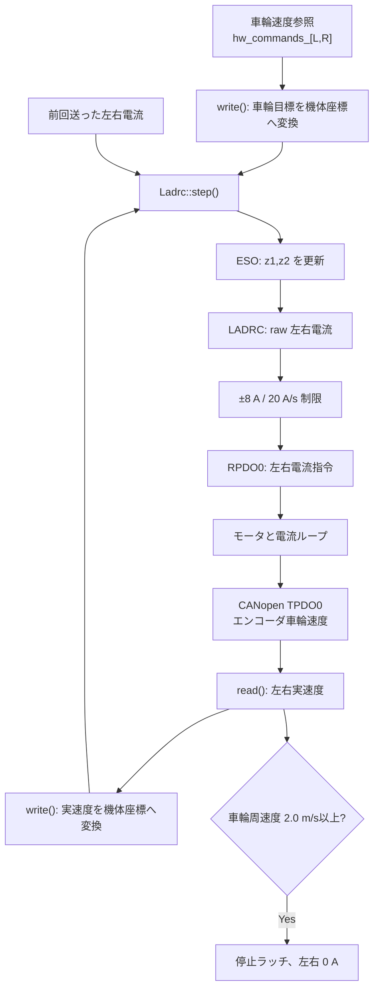

# 学習教材：BREAKAWAYなし MIMO-LADRC のC++実装を数式とともに読む

> 対象ブランチ：`zlac8015d_hardware / experiment/mimo-ladrc-no-breakaway`  
> 内容を確認したコミット：`6375092965dd62762990edf37cfd5047b6465cc8`（2026-11-17時点）  
> このファイルは**学習・読解用のみ**。制御プログラム、ゲイン、CANopen設定を変更しない。  
> **範囲**：`mimo-ladrc-no-breakaway` の制御経路のみ。`cmd_vel` 計測Python、MIMO-PID、旧BREAKAWAY制御の詳細解説は対象外。

## この教材の目標

読み終えた時に、以下をソースの行・数式と対応させて説明できるようにする。

1. エンコーダの左右車輪速度が、機体速度 `v` と角速度 `ω` に変換される過程。
2. `b0`、入力行列 `B`、ESOの `z1` と `z2` が表す物理量。
3. `Ladrc::step()` が **前回電流→ESO→速度誤差→外乱補償→左右電流** の順に計算すること。
4. BREAKAWAYを使わなくても静止状態から制御則が呼ばれる理由。
5. 電流上限、電流変化率、過速度停止、フィードバックタイムアウトの違い。
6. 現在の等帯域幅設定で、MIMO形式の制御則が車輪独立の式に変換できる理由。

---

## 1. ソースコードの地図

この実験モードを理解するために**最初に読むべき3ファイル**：

| ファイル | 学ぶべき機能・関数 | 重要度 |
|---|---|---|
| [`include/zlac8015d_hardware/mimo_control.hpp`](include/zlac8015d_hardware/mimo_control.hpp) | `DifferentialDriveModel`、`Ladrc::reset_to_measurement()`、`Ladrc::step()`、`wheel_overspeed()` | 制御の数学 |
| [`include/zlac8015d_hardware/zlac8015d_system.hpp`](include/zlac8015d_hardware/zlac8015d_system.hpp) | `ControlMode`、`experimental_no_breakaway_`、`mimo_ladrc_`、`hw_velocities_`、電流上限などのメンバー | 状態変数 |
| [`src/zlac8015d_system.cpp`](src/zlac8015d_system.cpp) | `on_init()`、`on_activate()`、`read()`、`write()`、`send_zero_command()` | 実機実装 |

処理の順番：



重要なのは、**ソースに残っている旧BREAKAWAY関数が実験モードで動くとは限らない**ということ。実験用分岐は`write()`内で電流送信後に`return`するため、以降の旧BREAKAWAY処理は通らない。

---

## 2. まずベクトルの順序と単位を固定する

この実装の車輪順序は**左、右**：

```math
\boldsymbol q =
\begin{bmatrix}\omega_L\\\omega_R\end{bmatrix},
\quad
\boldsymbol u =
\begin{bmatrix}I_L\\I_R\end{bmatrix},
\quad
\boldsymbol y =
\begin{bmatrix}v\\\omega\end{bmatrix}
```

| 記号 | 意味 | 単位 |
|---|---|---|
| `ω_L, ω_R` | 左右車輪角速度 | rad/s |
| `I_L, I_R` | 左右モータへの**指令**電流 | A |
| `v` | エンコーダから換算した並進速度 | m/s |
| `ω` | エンコーダから換算した機体角速度 | rad/s |
| `r` | 車輪半径 | 0.064 m |
| `ℓ` | 車輪間隔 | 0.354 m |
| `b_L, b_R` | 車輪速度変化率に対する公称電流ゲイン | (rad/s²)/A |

- 左右車輪が同じ正速度なら前進。
- 右車輪が左車輪より速ければ、機体は正方向（反時計回り）に旋回。
- ロボットの**実際の地面に対する速度**とは限らない。車輪が滑ればエンコーダ換算値と実移動速度は異なる。

### 2.1 差動二輪の運動学

```math
v = \frac{r}{2}(\omega_L+\omega_R),
\qquad
\omega = \frac{r}{\ell}(\omega_R-\omega_L)
```

```math
\boldsymbol y = \boldsymbol T\boldsymbol q,
\qquad
\boldsymbol T =
\begin{bmatrix}
r/2 & r/2\\
-r/\ell & r/\ell
\end{bmatrix}
```

`mimo_control.hpp` の実装：

```cpp
const double half_r = wheel_radius * 0.5;
const double yaw_scale = wheel_radius / wheel_separation;

T = {{{half_r, half_r}, {-yaw_scale, yaw_scale}}};
T_inv = inverse(T);
```

- `T`：左右車輪速度から `[v,ω]` を求める。
- `T_inv`：`[v,ω]` から左右車輪速度を求める。
- `Mat2` は `std::array<std::array<double,2>,2>` に相当する2×2行列。

逆変換は

```math
\omega_L=\frac{v}{r}-\frac{\ell\omega}{2r},
\qquad
\omega_R=\frac{v}{r}+\frac{\ell\omega}{2r}
```

である。

### 2.2 数値例：直進目標0.10 m/s

`v_ref=0.10 m/s`、`ω_ref=0` の場合：

```math
\omega_{L,\mathrm{ref}}=
\omega_{R,\mathrm{ref}}=
\frac{0.10}{0.064}
=1.5625\ \mathrm{rad/s}
```

左右輪は同じ速度に追従すれば直進する。後で第7章の「最初の電流指令」を計算する際、この値を使う。

---

## 3. 公称制御対象と入力行列B

### 3.1 車輪の一次モデル

コードは左右車輪を、電流指令が角加速度に作用する次の近似モデルで表現する。

```math
\dot{\boldsymbol q}
=
\begin{bmatrix}
b_L&0\\0&b_R
\end{bmatrix}
\boldsymbol u
+
\boldsymbol f_q
```

- `b_L=b_R=18` は現在の**公称ゲイン**。
- `f_q=[f_L,f_R]^T` は摩擦、路面負荷、電流応答遅れ、公称モデル誤差などの**等価外乱**。モータの負荷トルクだけを測定したものではない。
- 公称モデルは **2つの車輪をそれぞれ一次の積分系**として近似している。実モータの全ての電気・機械ダイナミクスを識別モデルに含めたという意味ではない。

### 3.2 機体座標に変換する

```math
\dot{\boldsymbol y}
=
\boldsymbol B\boldsymbol u
+
\boldsymbol f,
\quad
\boldsymbol B=
\boldsymbol T
\begin{bmatrix}b_L&0\\0&b_R\end{bmatrix},
\quad
\boldsymbol f=\boldsymbol T\boldsymbol f_q
```

```math
\boldsymbol B=
\begin{bmatrix}
r b_L/2&r b_R/2\\
-r b_L/\ell&r b_R/\ell
\end{bmatrix}
```

数値代入すると：

```math
\boldsymbol B \simeq
\begin{bmatrix}
0.576 & 0.576\\
-3.25424 & 3.25424
\end{bmatrix}
```

`mimo_control.hpp`：

```cpp
B = {{{T[0][0] * b_left, T[0][1] * b_right},
      {T[1][0] * b_left, T[1][1] * b_right}}};
B_inv = inverse(B);
```

**なぜ `B_inv` が必要か？** LADRCが生成するのはまず「機体に与えたい並進加速度・角加速度」である。それを**左右電流指令**へ変換するため、`u = B_inv * desired_acceleration` とする。

---

## 4. ESO：観測できない総外乱を推定する

### 4.1 ESOが推定する2つの状態

`mimo_control.hpp` 内のクラス：

```cpp
class Ladrc
{
public:
  Vec2 z1{{0.0, 0.0}};
  Vec2 z2{{0.0, 0.0}};
  bool initialized{false};
  // ...
};
```

- `z1 = [hat_v, hat_omega]`：機体の**並進速度・角速度の推定値**。
- `z2 = [hat_f_v, hat_f_omega]`：機体座標での**総外乱加速度の推定値**。
- `z2[0]` の単位はm/s²、`z2[1]` の単位はrad/s²。**A（電流）ではない**。

モデル：

```math
\dot{\boldsymbol y}=\boldsymbol B\boldsymbol u+\boldsymbol f
```

この未知の `f` を状態として拡張し、一次のLESOを使用する。

```math
\begin{aligned}
\dot{\boldsymbol z}_1 &=
\boldsymbol z_2
+\boldsymbol B\boldsymbol u_{\mathrm{prev}}
+2\boldsymbol\Omega_o(\boldsymbol y-\boldsymbol z_1),\\
\dot{\boldsymbol z}_2 &=
\boldsymbol\Omega_o^2(\boldsymbol y-\boldsymbol z_1).
\end{aligned}
```

```math
\boldsymbol\Omega_o=
\begin{bmatrix}
\omega_{o,v}&0\\
0&\omega_{o,\omega}
\end{bmatrix}
=
\begin{bmatrix}
20&0\\0&20
\end{bmatrix}
\ \mathrm{rad/s}
```

ここで `y-z1` は **実測速度−推定速度**。この符号を逆にしてしまうとESOの補正方向が変わる。

### 4.2 なぜESOゲインが「2ωo」と「ωo²」なのか

公称入力による速度変化を既知とし、各軸の推定誤差を線形化した場合、ESOの誤差特性多項式は

```math
s^2+\beta_1s+\beta_2
```

となる。両極を `-ωo` に置くと：

```math
(s+\omega_o)^2=s^2+2\omega_os+\omega_o^2
```

係数比較によって

```math
\beta_1=2\omega_o,
\qquad
\beta_2=\omega_o^2
```

を採用している。

- `ωo` が大きいほど理想化された観測器の収束は速い。
- 一方、計測ノイズ・遅延・離散化の影響にも敏感になり得る。
- **`ωo=20` だから実機外乱が必ず20 rad/sで正確に推定されるわけではない**。

### 4.3 C++のEuler離散化を追う

`Ladrc::step()` より：

```cpp
const Vec2 known_acceleration =
    multiply(model.B, previous_current);

for (std::size_t i = 0; i < 2; ++i) {
  const double error = measured[i] - z1[i];
  const double z1_dot =
      z2[i] + known_acceleration[i]
      + 2.0 * wo[i] * error;
  const double z2_dot = wo[i] * wo[i] * error;
  z1[i] += dt * z1_dot;
  z2[i] += dt * z2_dot;
}
```

**実行順**：

1. 前回送信した電流指令 `previous_current` を `B` で掛け、既知の加速度を計算。
2. 実測値と前回の推定 `z1` の差 `error` を計算。
3. `z1_dot`、`z2_dot` を計算。
4. `dt` を掛けて推定値を更新する。

Euler更新式：

```math
\begin{aligned}
\boldsymbol z_1[k+1]&=
\boldsymbol z_1[k]+\Delta t\,\dot{\boldsymbol z}_1[k],\\
\boldsymbol z_2[k+1]&=
\boldsymbol z_2[k]+\Delta t\,\dot{\boldsymbol z}_2[k].
\end{aligned}
```

200 Hzなら公称`Δt=1/200=0.005 s`。

**誤解しやすい点：** `previous_current` は名前に関係なく **実電流フィードバックではない**。`write()` で前周期に保存された `last_current_cmd`、すなわち指令電流を使用している。ドライバ内部の電流追従誤差も `z2` に含まれ得る。

---

## 5. LADRC制御則：速度誤差と外乱推定を電流に変換

### 5.1 目標加速度を作る

ESO更新後に実行される部分：

```cpp
Vec2 desired_acceleration{};
for (std::size_t i = 0; i < 2; ++i) {
  desired_acceleration[i] =
      acceleration_feedforward[i]
      + wc[i] * (reference[i] - z1[i])
      - z2[i];
}
return model.acceleration_to_current(desired_acceleration);
```

数式：

```math
\boldsymbol a_{\mathrm{des}}
=
\boldsymbol a_{\mathrm{ff}}
+
\boldsymbol\Omega_c(\boldsymbol y_{\mathrm{ref}}-\boldsymbol z_1)
-
\boldsymbol z_2
```

```math
\boldsymbol\Omega_c=
\begin{bmatrix}
\omega_{c,v}&0\\0&\omega_{c,\omega}
\end{bmatrix}
=
\begin{bmatrix}5&0\\0&5\end{bmatrix}
\ \mathrm{rad/s}
```

次に

```math
\boxed{
\boldsymbol u_{\mathrm{raw}}
=
\boldsymbol B^{-1}
\left[
\boldsymbol a_{\mathrm{ff}}
+\boldsymbol\Omega_c(\boldsymbol y_{\mathrm{ref}}-\boldsymbol z_1)
-\boldsymbol z_2
\right]
}
```

を計算する。

| C++変数 | 数式 | 意味 |
|---|---|---|
| `reference` | `y_ref` | 機体速度目標 |
| `measured` | `y` | エンコーダから求めた速度 |
| `z1` | 推定`y` | LADRCが速度誤差計算に使う速度推定 |
| `z2` | 推定`f` | 総外乱を打ち消す補償項 |
| `wc` | `Ωc` | 速度追従の帯域幅 |
| `acceleration_feedforward` | `a_ff` | 通常停止時の減速加速度入力 |
| `model.B_inv` | `B⁻¹` | 仮想加速度→左右電流 |
| `raw` | `u_raw` | 制限前の左右電流指令 |

**`z2` の符号がマイナスなのはなぜ？** モデルでは外乱が `+f` として加速度に加わるため、制御則で `-hat_f` として相殺しようとするからである。負の外乱が推定されれば、`-z2` は正の補償加速度となる。

### 5.2 LADRCはPI/PIDと何が違う？

この実装のLADRCには**明示的な積分誤差状態や微分誤差項を直接置いていない**。ESOの状態 `z2` が、未知の影響をまとめて推定し、制御入力から差し引く。PIDの積分補償と外乱推定は同じ演算ではない。

---

## 6. 発進の実装：どこでBREAKAWAYを通らないか

### 6.1 制御モードの選択

`src/zlac8015d_system.cpp::on_init()`：

```cpp
} else if (mode == "mimo_ladrc_no_breakaway") {
  control_mode_ = ControlMode::MIMO_LADRC_TORQUE;
  experimental_no_breakaway_ = true;
}
```

内部で通常のMIMO-LADRC用列挙値を再利用するが、**`experimental_no_breakaway_` の真偽で専用経路に入る**。

### 6.2 `write()` における専用経路

`write()` の処理を簡略化：

```cpp
if (experimental_no_breakaway_) {
  const bool active_reference =
      !zero_stop_hold_ &&
      (std::abs(control_ref_l) > 1.0e-6 ||
       std::abs(control_ref_r) > 1.0e-6);

  if (!active_reference) {
    mimo_ladrc_.reset();
    mimo_was_ready_ = false;
    send_zero_command();
    return hardware_interface::return_type::OK;
  }

  // ... 初期化、Ladrc::step()、電流制限、CAN送信 ...
  return send_experimental(cmd_l, cmd_r);
}
```

`active_reference` は **速度が実際に出ているか** ではなく、**非ゼロの目標車輪速度が与えられたか**を判定する。よって、初速0 rad/sでも非ゼロ目標ならLADRCを計算する。

- **BREAKAWAY開始電流を強制しない**。
- 車輪が一定速度に達するまで待つ条件を設けない。
- 方向反転時も非ゼロ参照が続けば同じLESO・LADRCを継続する。
- `send_experimental()` 後に `return` するので、後方の `compute_current_command()`（旧BREAKAWAYを含む）は**このモードでは呼ばれない**。

### 6.3 ESOの初期化はいつ行われるか

```cpp
if (!mimo_was_ready_) {
  mimo_ladrc_.reset_to_measurement(measured_body);
  mimo_was_ready_ = true;
}
```

`reset_to_measurement()` は

```cpp
z1 = measured;
z2 = {{0.0, 0.0}};
initialized = true;
```

を行う。ここで `measured` は機体座標 `[v,ω]`。完全静止状態なら`z1=[0,0]`、`z2=[0,0]`から始まる。停止解除直後に「静止摩擦が何Nか」を最初から既知としているわけではない。

**静止中に外乱を推定できるか？** モータに電流を指令しても車輪速度が増加しない場合、モデルが予測する加速度と実測速度が食い違う。ESOはこの差を総外乱へ反映し、次の周期の電流指令を増加させる場合がある。だが静止摩擦は非線形であり、**8 A上限に達しても発進できない可能性がある**。

---

## 7. 発進時の実際の電流を手計算する

条件：

- `v_ref=0.10 m/s, ω_ref=0`
- 車輪は完全静止 `ω_L=ω_R=0`
- ESOは初期化直後 `z1=0, z2=0`
- `b_L=b_R=18, ωc=5`
- 停止フィードフォワード0

この条件では左右輪の初回**制限前**の電流は：

```math
I_{L,\mathrm{raw}}=
I_{R,\mathrm{raw}}=
\frac{\omega_c\,\omega_{\mathrm{wheel,ref}}}{b_0}
=
\frac{5(0.10/0.064)}{18}
\simeq0.4340\ \mathrm A
```

しかし電流変化率の上限は`20 A/s`。5 ms周期なら1周期で変えられる電流は

```math
\Delta I_{\max}=20\times0.005=0.10\ \mathrm A
```

なので、前回指令が0 Aなら **初回の最終出力は左右とも+0.10 A** に制限される。

**学習上のポイント**：`b0=18` と `wc=5` で初回に0.434 Aの制御要求が生じても、ドライバへは0.1 Aしか送られない。この差を無視すると「LADRCが発進できない」ときの原因を誤って解釈する。LESOの`previous_current`には**送信した0.1 A** が次周期入力される。

---

## 8. 電流指令の制限：8 A と 20 A/s

`write()` の実装：

```cpp
const double imax = no_breakaway_current_limit_a_;
const double di = current_rate_limit_a_per_s_ * dt;

double cmd_l = clamp(
    clamp(raw[0], -imax, imax),
    current_l_measured - di,
    current_l_measured + di);
double cmd_r = clamp(
    clamp(raw[1], -imax, imax),
    current_r_measured - di,
    current_r_measured + di);

cmd_l = clamp(cmd_l, -imax, imax);
cmd_r = clamp(cmd_r, -imax, imax);
```

数式：

```math
I_{\mathrm{sat}}[k]=
\mathrm{clip}(I_{\mathrm{raw}}[k],-8,8)
```

```math
I_{\mathrm{cmd}}[k]=
\mathrm{clip}\left(
I_{\mathrm{sat}}[k],
I_{\mathrm{cmd}}[k-1]-20\Delta t,\,
I_{\mathrm{cmd}}[k-1]+20\Delta t
\right)
```

最後にもう一度±8 Aへ制限する。

- **8 A**：指令電流の絶対値上限。
- **20 A/s**：1秒あたりの**指令の変化量**上限。
- これらは`I_actual`（ドライバから返る実電流）の理想追従を保証しない。
- 片輪が拘束された場合に他輪を連動して止めるロジックは**この実験モードにはない**。
- 拘束状態で8 Aの指令を出し続けることを防ぐ専用の低速・高電流保護も**現在は削除されている**。

---

## 9. CANopen：制御入力と実測値はどこで行き来するか

### 9.1 `on_activate()`：通信とドライバの初期化

`on_activate()` で行う主要処理：

1. Linux SocketCAN `can0`を`socket()`/`bind()` で接続し、非ブロッキングで運用。
2. `configure_feedback_pdos()` で速度、電流、位置を返すTPDOのマッピングを設定。
3. `configure_torque_rpdo()` で左右目標電流を受けるRPDOを設定。
4. CiA402モード `6060h=4`（Profile Torque）を設定。
5. CiA402制御ワードでサーボONへ移行し、ゼロ電流を初期送信。
6. ESOと運転状態をリセットし、`no_breakaway_overspeed_latched_=false` とする。

`mode` の切替えと安全ラッチの再初期化は**実行中のライブ切替えを想定していない**。

### 9.2 `read()`：エンコーダ・実電流を取り込む

| CAN-ID（node_id=1） | 内容 | 単位と処理 |
|---|---|---|
| `0x181`（TPDO0） | 左右実車輪速度（`606Ch`） | 0.1 rpm→rad/s、左のみ符号反転 |
| `0x281`（TPDO1） | 左右実電流（`6077h`） | 0.1 A→A、左のみ符号反転 |
| `0x381`（TPDO2） | 左右エンコーダ位置（`6064h`） | 32bit計数を積算、4096 counts/rev |
| `0x201`（RPDO0） | 左右目標電流（`6071h`） | A→mA、左のみ符号反転 |

実測速度の変換：

```cpp
hw_velocities_[0] =
    -static_cast<double>(val_l) * RPM01_TO_RAD_PER_SEC;
hw_velocities_[1] =
     static_cast<double>(val_r) * RPM01_TO_RAD_PER_SEC;
```

左モータのドライバ回転正方向はROS正方向と逆なので、左側だけ負号が付く。これは**モータ配線・取り付け方向に依存する実機固有の符号処理**。

### 9.3 `write()`：電流を送る

`send_experimental()` の核心：

```cpp
const int16_t left_ma = static_cast<int16_t>(
    std::lround(-cmd_l * 1000.0));
const int16_t right_ma = static_cast<int16_t>(
    std::lround( cmd_r * 1000.0));

experimental_frame.can_id = 0x200u + node_id_;
experimental_frame.can_dlc = 4;
std::memcpy(&experimental_frame.data[0], &left_ma, 2);
std::memcpy(&experimental_frame.data[2], &right_ma, 2);
```

上は**処理の要点だけ**を抜いた例。実際のソースは整数変換前に電流を`clamp()`し、`write()`エラーも確認する。

- 左右電流は**同じCANフレーム**に格納。
- `cmd_l/r` はROS前進基準の符号、ドライバへ渡す前に左側だけ反転。
- `send_zero_command()` はトルクモードで同じRPDO0に左右0 mAを送信し、`last_current_cmd` を0に戻す。

---

## 10. 安全処理と優先順位

### 10.1 車輪周速度2.0 m/sで電流0 A

`mimo_control.hpp`：

```cpp
inline bool wheel_overspeed(
  const Vec2 & measured_wheel_rad_s,
  const double wheel_radius_m,
  const double max_peripheral_speed_m_s = 2.0)
```

判定：

```math
\max(|\omega_L|,|\omega_R|)
\geq
\frac{2.0}{0.064}
=31.25\ \mathrm{rad/s}
```

`read()`は受信した**各TPDO0フレームごと**に閾値を評価。どちらかの車輪が超過すると`no_breakaway_overspeed_latched_=true`。

`write()`では、ESO・LADRCを計算するよりも先に、

```cpp
if (experimental_no_breakaway_ &&
    no_breakaway_overspeed_latched_) {
  send_zero_command();
  log_ladrc_runtime(0.0, 0.0);
  return hardware_interface::return_type::OK;
}
```

を実行する（コードから抜粋して簡略化）。

- 車輪が速度閾値を下回っても停止フラグは維持。
- `cmd_vel=0`でも解除しない。`on_activate()`で再初期化。
- **0 Aは機械ブレーキや安全認証された非常停止ではない**。実機の車輪は惰性で回る可能性がある。

### 10.2 速度フィードバックが来ない場合

`write()` は

- 一度も速度を受信していない→0 A。
- 最後の速度フィードバック受信から**30 ms超**→0 A送信を試み、`ERROR`。
- LADRC演算結果が非有限値→0 A送信を試み、`ERROR`。

というチェックを行う。

**重要：** 電流0 A送信は通信が成立して初めてモータへ届く。ROSとCANが止まった場合の物理的な安全を保証するものではない。外部非常停止を使用する。

---

## 11. 通常停止時にESOとLADRCはどう動くか

外部の車輪速度参照が左右とも0になると、`write()` はすぐに生電流0 Aへ切り替えるのではなく、**通常停止ランプ**を作成する。

- 車輪角減速度の参照変化率：`1.0/0.064 = 15.625 rad/s²`。
- 走行中に停止が始まった場合は、停止開始時の**実測車輪速度**から目標をランプで0へ近づける。
- ランプ中は `body_stop_ff` に減速方向の加速度を加え、MIMO-LADRCで減速電流を計算する。
- 両輪の実測角速度が`0.5 rad/s`以下になると `zero_stop_hold_=true`。
- `ZERO HOLD` に入るとLESOをリセットし、左右0 Aに保持する。
- その後の新しい非ゼロ目標指令で`ZERO HOLD`を解除し、ESOを実測速度から再初期化する。

通常停止は**加速度参照を制限する処理**で、物理的な停止距離や実減速度を保証するものではない。過速度ラッチは通常停止より優先される。

---

## 12. MIMOなのに、なぜ現在のゲインでは左右独立LADRCと等価になるのか

同じプログラムでの設定は

```math
\boldsymbol\Omega_c=
\begin{bmatrix}5&0\\0&5\end{bmatrix}
=5\boldsymbol I,
\quad
\boldsymbol\Omega_o=
\begin{bmatrix}20&0\\0&20\end{bmatrix}
=20\boldsymbol I.
```

制御則を車輪座標へ変換すると、`D_b=diag(b_L,b_R)`として

```math
\boldsymbol u
=
\boldsymbol D_b^{-1}
\left[
\boldsymbol T^{-1}\boldsymbol\Omega_c\boldsymbol T
(\boldsymbol q_{\mathrm{ref}}-\hat{\boldsymbol q})
-\hat{\boldsymbol f}_q
\right]
```

となる（通常停止のフィードフォワードは省略）。

`Ωc=5I` だから

```math
\boldsymbol T^{-1}\boldsymbol\Omega_c\boldsymbol T
=\boldsymbol T^{-1}(5\boldsymbol I)\boldsymbol T
=5\boldsymbol I
```

と簡単になる。LESOも`Ωo=20I`なので車輪ごとのESOに座標変換でき、理想化条件の下で

```math
I_L=\frac{5(\omega_{L,\mathrm{ref}}-\hat\omega_L)-\hat f_L}{b_L},
\quad
I_R=\frac{5(\omega_{R,\mathrm{ref}}-\hat\omega_R)-\hat f_R}{b_R}
```

という**左右独立の形**に還元される。

**重要な留保**：等価なのは、同じ入力モデル、ゲイン、座標変換、ESO更新条件を前提とした**数理上の制御構造**。接地すべり、通信遅延、電流飽和、実機の左右干渉が存在するため、実際の軌跡や性能が常に完全一致するとは断定できない。

### 12.1 異なる外乱と直進誤差

左右で外乱が異なるとき、機体角速度方向の等価外乱は

```math
f_\omega=\frac r\ell(f_R-f_L)
```

となる。左右車輪の速度差が残ると

```math
\omega=\frac r\ell(\omega_R-\omega_L)
```

によって機体は意図せず旋回する。

ただし左右独立でも、それぞれのESOが外乱を十分に補償すれば速度差を抑制できる。**左右独立だから必ず直進性能が低下する**という結論は導けない。

### 12.2 帯域を変えた場合の結合の例（**現行コードの設定ではない**）

例えば`wc_v=5`、`wc_omega=10`なら、

```math
\boldsymbol T^{-1}
\begin{bmatrix}5&0\\0&10\end{bmatrix}
\boldsymbol T
=
\begin{bmatrix}7.5&-2.5\\-2.5&7.5\end{bmatrix}
```

となり、非対角項によって左右輪の誤差フィードバックが結合する。しかし、ヨー帯域を上げれば必ず走行精度が良くなるわけではない。遅れ・飽和・ESOのノイズ感度・安定余裕の検証が必要。

---

## 13. ハードウェア200 Hzログを制御式に対応させる

`src/zlac8015d_system.cpp::log_ladrc_runtime()` が以下を保存する。

保存先：`/tmp/mimo_ladrc_no_breakaway_200hz.csv`。

| CSV列 | どの変数を見ているか |
|---|---|
| `ref_left_rad_s, ref_right_rad_s` | `hw_commands_[0/1]`：外部から受けた車輪角速度目標 |
| `vel_left_rad_s, vel_right_rad_s` | `hw_velocities_[0/1]`：エンコーダ速度 |
| `cmd_current_left_A, cmd_current_right_A` | 制限後に送る指令電流 |
| `actual_current_left_A, actual_current_right_A` | `hw_efforts_[0/1]`：実電流 |
| `z1_left, z1_right` | `T_inv * mimo_ladrc_.z1`：車輪座標での速度推定 |
| `z2_left, z2_right` | `T_inv * mimo_ladrc_.z2`：車輪座標での等価外乱推定 |
| `ref_v_m_s, ref_omega_rad_s` | `T * hw_commands_`：機体速度目標 |
| `v_m_s, omega_rad_s` | `T * hw_velocities_`：エンコーダ換算の機体速度 |
| `hat_v_m_s, hat_omega_rad_s` | 機体座標のESO `z1` |
| `hat_d_v_m_s2, hat_d_omega_rad_s2` | 機体座標のESO `z2` |
| `wheel_overspeed_latched` | 過速度保護のラッチ状態、0/1 |

- 目標車輪速度CSVは`hw_commands_`由来なので、停止中の内部ランプ参照 `control_ref_l/r` と同じではない場合がある。
- `z2` を車輪座標へ変換したものも外乱**加速度相当**で、モータトルクを直接測ったものではない。
- `time_s` は最初のCSV初期化からの時間で、ROS別プロセスの時刻とは原点が違う。
- ファイルは制御プログラム稼働中に書き込むため、完全なコピー・解析は安全に停止してから行う。

---

## 14. ソースを読むための5つの演習問題

学習用なので、先に問題だけ自分で解き、以下の解答を確認する。

**問題1**　`v_ref=0.20 m/s`、`ω_ref=0` の目標左右車輪角速度はいくつか。

**問題2**　ESOの`z2=[-0.1,0.0]`と仮定する（機体座標）。他の項を一定とすると、`-z2`は並進方向の指令加速度を増やすか、減らすか。

**問題3**　周期5 ms、前回電流1.0 A、生電流要求5.0 Aなら、その周期に送る電流はいくつか。

**問題4**　`mimo_was_ready_` が`false`の時、`reset_to_measurement()`は`z1`と`z2`をそれぞれ何にするか。

**問題5**　右輪の実測角速度35 rad/s、左輪0 rad/sのとき、正常な速度指令が届いていても次の`write()`はどの処理を優先するか。

<details>
<summary>演習の解答</summary>

1. 両輪とも`0.20/0.064=3.125 rad/s`。
2. `-z2=[+0.1,0]`なので、並進方向の指令加速度が増える。
3. 変化率限界は`20×0.005=0.10 A`、よって最大`1.10 A`。
4. `z1=measured_body`、`z2=[0,0]`。測定値ゼロなら`z1=[0,0]`。
5. `35×0.064=2.24 m/s`で2.0 m/s超過。過速度ラッチを優先し、両輪0 Aを指令する。

</details>

---

## 15. 最終確認：実行経路を1行で説明できるか

`hw_commands_`（車輪目標角速度） → `read()`で得た`hw_velocities_`（車輪実速度） → `DifferentialDriveModel::wheel_to_body()`で`[v,ω]`へ → `Ladrc::step()`で`z1,z2`推定と左右`raw`電流 → **8 A・20 A/s制限** → `send_experimental()`でCANopen RPDO0へ送信 → 次周期のESOへ前回電流として戻す。

**まとめ：** BREAKAWAYなしモードの核心は、`write()`内で**実速度の立ち上がりを条件にせず** `Ladrc::step()` を呼ぶ専用分岐にある。ESOは総外乱を推定できるが静止摩擦に必ず打ち勝てるとは限らない。過速度2.0 m/sは両輪0 A指令のソフトウェア保護であり、物理ブレーキではない。
